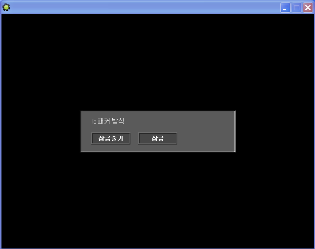

# 게임메이커 LIB 잠금·해제 도구

게임메이커의 액션 라이브러리 파일(`.lib`)에 편집 잠금을 걸거나 푸는 도구다. 잠긴 `.lib` 는 라이브러리 메이커로 열어 편집할 수 없다. 게임메이커의 lib 파일 포맷을 리버싱해서 만들었다.

<p>
  
</p>


## 사용 방법

Releases에서 받아 실행한 뒤 잠금과 해제 중 하나를 고르고 `.lib` 파일을 선택한다. 완료 메시지가 뜨고 확인을 누르면 종료된다. 파일을 그 자리에서 고치므로 먼저 백업해두는 게 좋다.


## 구현 원리

잠금 여부는 `.lib` 안에 적힌 라이브러리 ID 가 정한다. 파일 앞쪽에 버전 4바이트와 이름 길이가 오고 이름 바로 뒤에 ID 가 이어지므로, 오프셋 4의 바이트로 이름 길이를 읽고 그만큼 뒤(`8 + 이름 길이`)의 2바이트를 고친다. 게임메이커는 ID 가 작은 라이브러리를 내장 라이브러리로 취급해 편집을 막는다. 그래서 잠금은 그 자리를 `01 00` 으로 덮어 ID 를 1로 만들고, 해제는 임의값을 써서 큰 ID 로 되돌린다.

```gml
open = file_bin_open(file_open, 2)
file_bin_seek(open, 4)
seek = file_bin_read_byte(open)        // 이름 길이
file_bin_seek(open, 8+seek)            // 라이브러리 ID 위치

// 잠금: ID 를 1 로
file_bin_write_byte(open, 1)
file_bin_write_byte(open, 0)

// 해제: 임의의 큰 ID 로
file_bin_write_byte(open, round(random(230))+10)
file_bin_write_byte(open, round(random(230))+10)
```

헥스 에디터로 잠긴 `.lib` 와 풀린 `.lib` 를 비교해 이 2바이트가 잠금을 가르는 자리임을 찾아냈다.


## 파일

| 경로 | 내용 |
|---|---|
| `source/gamemaker-lib-lock-unlock.gmk` | 원본 프로젝트 파일 |
| `source/split/` | GmkSplitter로 분해한 텍스트 트리 |
| `docs/screenshots/` | 스크린샷 |
| Releases | 실행 파일과 사용 설명 |


## 라이선스

zlib 라이선스다. 자세한 내용은 [LICENSE](LICENSE) 에 있다.
